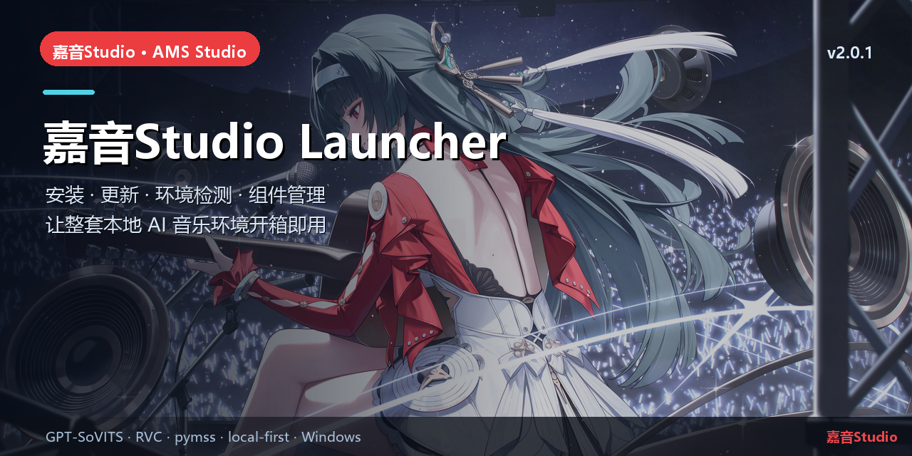

# 嘉音Studio Launcher

> 安装 · 更新 · 环境检测 · 组件管理 · Kernel/Gateway 生命周期


## 简介

嘉音Studio 的 Windows 桌面启动器，使用 **Tauri 2 + Vue 3 + Rust**。
它把一整套本地 AI 音乐环境装好、检查好、启动好：组件下载与校验、环境检测、Gateway/Kernel 启停、插件安装、音源库与更新中心。

当前版本 **2.0.1**（启动器环境检测修复版）。

## 核心能力

- 环境检测：Windows/GPU/WebView2/VC++/Node/Gateway/RVC/FFmpeg/GPT-SoVITS/pymss/MSVC/音源/磁盘。
- 组件安装：读取签名 feed，按分卷下载、校验 SHA256、解包到安装目录。
- 托管运行时：扫描 `data/runtime/<组件>/<版本>`，不写死版本号。
- Kernel/Gateway 启停与日志、插件安装、更新中心、默认音色安装。

## 本仓库

主要代码：
- `src/`：Vue 启动器界面
- `src-tauri/`：Rust/Tauri 后端与环境检测
- `installer/`：NSIS 打包脚本与历史安装产物

构建需要 Node.js/pnpm + Rust 工具链；详细构建步骤见 `installer/README` 或项目文档。

## 快速开始

```powershell
pnpm install
pnpm build
pnpm tauri build --bundles nsis
```

## 相关链接

- 总仓库：[yan-mc/AMS-Studio](https://github.com/yan-mc/AMS-Studio)
- 最新发布：[yan-mc/ams-release releases](https://github.com/yan-mc/ams-release/releases)
- 当前版本：**嘉音Studio v2.0.1**（feed 2058）
- 文档：[ams-docs](https://github.com/yan-mc/ams-docs)

## 说明

- 所有音乐数据默认留在安装目录 `data/`；Gateway 只监听 `127.0.0.1`。
- 本项目为本地优先工具，不提供云端上传；使用第三方模型/音频时请遵守各自许可。
- License: MIT (see `LICENSE`).
